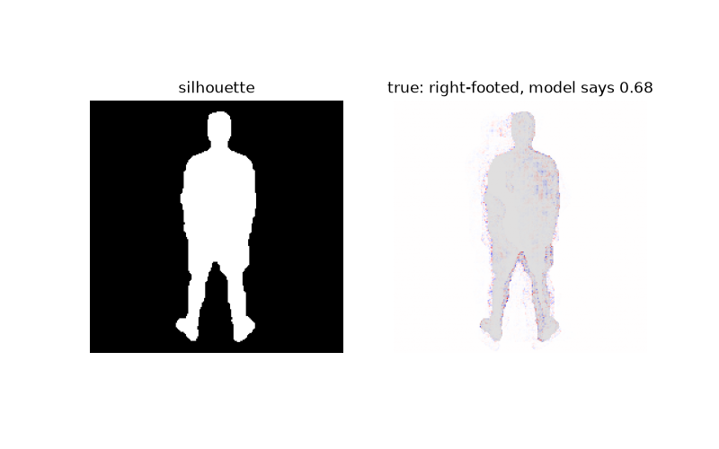

# PenaltyTellsWithCNNs

This code tests the use of CNNs and the use of SHAP heat maps in an attempt to see if a player's body language provides a hint to the direction that they are shooting on a penalty.

In this, I use rear camera shots of penalties, mostly from international tournament fixtures where this is common to get an up close view of a player's body language before a kick.

So far, I don't believe I have enough data, with 85 images being used in combination with Resnet, but i aim to reach at least 200 before drawing any form of conclusion.
I have also recorded pose data, as well as run up angle and distance data for future use in combination with the CNN.

I will outline the method I have used below:

### Method

#### Choosing the images:

Penalties were only chosen where:

- The player had not begun their runup before the rear camera was adopted.
- the player was fully in frame of the rear camera before beginning their run up.

All images are of the player within 0.5 seconds of starting their run up.

Penalties that are scored down the middle are recorded, but not used to train the model or predict other penalties. This decision was made because there is not enough data for them.

#### Preprocessing:

The method in which the data is preprocessed takes into account the fact that the rear penalty camera is relatively new in football.

Therefore, data is limited, though maybe in the future this will be used more often, and in time, more data will appear.

Also, maybe synthetic data could help change this.

Anyway...
- The image starts as a cropped image of the player and the ball.

- The angle and run up distance between the player and the ball were recording and stored in a csv file.

- The background around each player was removed using Apple's Vision packages, leaving a cutout of the player. This removes all the clutter and the occasion surrounding the image.

- Data relating to the pose in the image was recorded for each player (for future use in combination with the model)

- Metadata relating to the penalty was recorded (ex: foot taken with, area of goal scored in)
- The image was then cropped and centred to a consistent size (224x224) \

- The background surrounding the image is then coloured completely black, whilst the player becomes a white silhouette. This disguises the arms and direction of the head etc, however with a small amount of data per team, and different kits each year, the model may begin to learn the patterns of the kits, and the shades of green of the pitch that the cutouts hadn't removed. I decided this was a needed trade off to stop the model from not learning the body language.

- The image was then ready.

- Left footed players are also mirrored on the X axis to greaten size and consistency of the training set.

Model

- I use a CNN to recognise image changes.
- I am testing two target variables, one being whether the shot went left or right, and one is whether a player has shot across their body, or towards the far corner. The second helps eliminate the grouping by foot, expanding the amount of training/validating data.
- Currently simple model as a baseline, with ResNet to help with detecting basic shapes early with such little data

Analysis

Then, I use SHAP Heatmaps to show the parts of the image that alter the model's decision.

Overfitting is clear to see as positive and negative sways are super close and don't follow clear body patterns, but this is only an example of the idea behind this project.

### Current Issues:

- Lack of data due to newish use of rear camera on penalty shootouts.
- Overfitting on model. Model is very simple and has not been tuned yet
